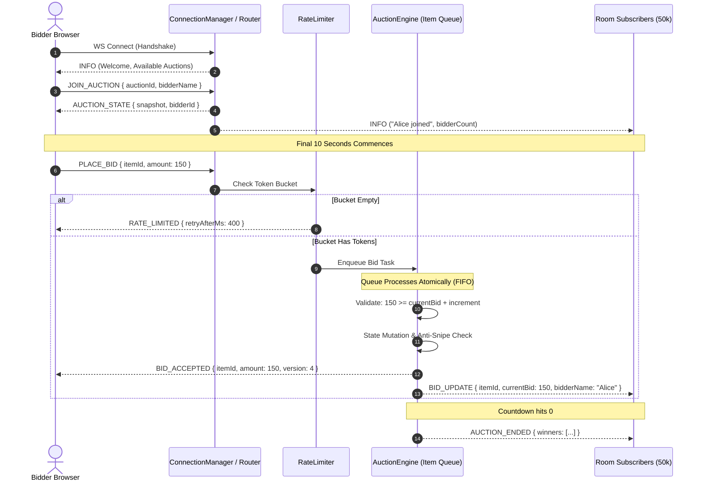

# BoltBid — Technical Architecture & Engineering Report: High-Concurrency Flash-Auction Engine

**Course:** Internet Computing  
**Topic:** Scalable Real-Time Client-Server Communication & Concurrency Control  
**Target Scenario:** 50,000 Concurrent Bidders in the Final 10 Seconds of Flash Auctions  

---

## 1. Executive Summary & Problem Formulation

In flash auctions, the final 10 seconds represent an extreme confluence of network concurrency, high write contention on shared state, and stringent low-latency requirements. 

A regional e-commerce platform transitioning to flash auctions reported three catastrophic failure modes using their traditional HTTP REST architecture:
1. **Severe Race Conditions (TOCTOU):** Multiple bidders simultaneously observed an identical current bid price, submitted increments, and were concurrently accepted as winning bids, resulting in inconsistent state, multiple phantom winners, or oversold items.
2. **Stale Reads & Polling Lag:** Even with aggressive HTTP polling (e.g., every 500 ms), the network round-trip time and HTTP request/response pipeline meant that clients made bidding decisions on outdated information.
3. **Server Thread & Socket Exhaustion:** 50,000 clients polling twice per second generated 100,000 HTTP requests per second. The resulting thread creation, TCP connection teardown, and header parsing overwhelmed traditional web servers (e.g., Apache/Tomcat/standard Express), crashing the backend infrastructure.

This document presents the architecture, engineering principles, and prototype implementation of **BoltBid** (the BoltBid Flash Auction Engine), a purpose-built system leveraging persistent WebSocket full-duplex communication and an atomic serialized queue processing engine.

---

## 2. Failure Analysis of HTTP REST Architectures

### 2.1 The Time-of-Check to Time-of-Use (TOCTOU) Dilemma
In a conventional REST API, placing a bid requires two logical phases:
1. `GET /api/auctions/{auctionId}/items/{itemId}` — Client retrieves the current highest bid $B_{curr}$.
2. `POST /api/auctions/{auctionId}/items/{itemId}/bids` — Client submits $B_{new} = B_{curr} + \Delta$.

```
Bidder 1:  ---[GET: B_curr = $100]--- ... validates ... ---[POST: $105]--- Accepted!
Bidder 2:  ----[GET: B_curr = $100]---- ... validates ... ---[POST: $102]--- Accepted! (Race!)
Bidder 3:  -----[GET: B_curr = $100]----- ... validates ... ---[POST: $110]--- Accepted! (Race!)
```

Because HTTP requests are stateless and handled across asynchronous worker threads or event loops without strict serialization, the state can mutate between the verification check and the database write. If two requests execute the query:
```sql
SELECT current_bid FROM items WHERE id = ?;
-- App checks: if (new_bid > current_bid + min_increment)
UPDATE items SET current_bid = ? WHERE id = ?;
```
both threads see the same uncommitted $B_{curr}$, both pass the application-level condition, and the last write wins, silently overwriting a higher bid with a lower one or double-awarding an item.

### 2.2 Network & Protocol Overhead (The Polling Trap)
For $N = 50,000$ active bidders attempting to maintain real-time visibility through short-polling:
- At a polling interval of $T = 500\text{ ms}$, the server must process:
  $$\text{Request Rate} = \frac{50,000}{0.5\text{ s}} = 100,000\text{ req/sec}$$
- Each standard HTTP/1.1 request contains roughly 500 to 1,000 bytes of headers (User-Agent, Cookies, Accept headers, TLS session metadata).
- **Ingress bandwidth overhead solely for idle polling:**
  $$100,000\text{ req/sec} \times 800\text{ bytes} \approx 80\text{ MB/sec} = 640\text{ Mbps}$$
- Most of these responses yield HTTP 304 (Not Modified) or identical state, saturating network interfaces and CPU cycles with zero utility.

### 2.3 The C10K / C50K Concurrency Barrier
Traditional multi-threaded servers allocate a separate operating system thread (or fiber) per incoming request. A stack size of 1 MB per thread across 50,000 concurrent requests requires:
$$\text{Memory} = 50,000 \times 1\text{ MB} = 50\text{ GB RAM}$$
merely for thread stacks, completely ignoring context-switching overhead and CPU cache invalidation.

---

## 3. High-Level System Architecture

To overcome these structural limitations, **BoltBid** replaces stateless polling with **persistent WebSocket connections** and combines them with an **event-driven, non-blocking single-process I/O loop** and **partitioned async queues**.

```
+-----------------------------------------------------------------------------------+
|                                 CLIENT TIER                                       |
|  [ Bidder 1 ]       [ Bidder 2 ]       [ Bidder 3 ]  ...       [ Bidder 50,000 ]  |
+-----------------------------------------------------------------------------------+
                                   │      ▲
              Full-Duplex TCP/WS   │      │ Bid Updates & Countdowns
                                   ▼      │
+───────────────────────────────────────────────────────────────────────────────────+
|                         COMMUNICATION & ROUTING TIER                              |
|                                                                                   |
|   ┌────────────────────────────────┐       ┌──────────────────────────────────┐   |
|   │     ConnectionManager.js       │       │        RateLimiter.js            │   |
|   │  - Sockets Map: O(1) Lookup    │       │  - Token Bucket Per Connection   │   |
|   │  - Room Sets: O(1) Broadcast   │       │  - Burst & Refill Enforcement    │   |
|   │  - Ping/Pong Heartbeat Pruner  │       │  - Fast Rejection (Microseconds) │   |
|   └────────────────────────────────┘       └──────────────────────────────────┘   |
|                                    │                                              |
|                                    ▼                                              |
|   ┌───────────────────────────────────────────────────────────────────────────┐   |
|   │                            MessageRouter.js                               │   |
|   │  - Protocol Deserialization & Structural Validation                       │   |
|   │  - Route dispatch: JOIN_AUCTION | PLACE_BID | LEAVE_AUCTION               │   |
|   └───────────────────────────────────────────────────────────────────────────┘   |
+──────────────────────────────────────────┬────────────────────────────────────────+
                                           │
                                           ▼
+───────────────────────────────────────────────────────────────────────────────────+
|                                CORE BIDDING ENGINE                                |
|                                                                                   |
|   ┌───────────────────────────────────────────────────────────────────────────┐   |
|   │                            AuctionEngine.js                               │   |
|   │                                                                           │   |
|   │   Item 1 Queue:       [ Bid 1 ] -> [ Bid 2 ] -> [ Bid 3 ]   (FIFO Async)  │   |
|   │   Item 2 Queue:       [ Bid 1 ] -> [ Bid 2 ]                (FIFO Async)  │   |
|   │   Item N Queue:       [ Bid 1 ] -> [ Bid 2 ] -> [ Bid 3 ]   (FIFO Async)  │   |
|   │                                                                           │   |
|   │   Atomic Execution Block:                                                 │   |
|   │     1. Verify Auction Active & Item In-Stock                              │   |
|   │     2. Check: Amount >= CurrentBid + MinIncrement                         │   |
|   │     3. Prevent Self-Outbidding                                            │   |
|   │     4. Mutate State: CurrentBid = Amount, Winner = Bidder                 │   |
|   │     5. Evaluate Anti-Snipe Trigger (Extend Timer if remaining <= 5s)      │   |
|   │     6. Dispatch Uni-cast BID_ACCEPTED & Broadcast BID_UPDATE              │   |
|   └───────────────────────────────────────────────────────────────────────────┘   |
+───────────────────────────────────────────────────────────────────────────────────+
```

---

## 4. Key Subsystem Design & Implementation

### 4.1 Per-Item Atomic Async Queue Serialization
To prevent race conditions without resorting to coarse global mutexes that would throttle the entire system, the engine implements a **partitioned queue strategy**.

Every auction item possesses an independent `AsyncQueue` instance:
```javascript
class AsyncQueue {
  constructor() {
    this._queue = [];
    this._processing = false;
  }

  enqueue(task) {
    return new Promise((resolve, reject) => {
      this._queue.push({ task, resolve, reject });
      this._processNext();
    });
  }

  async _processNext() {
    if (this._processing) return;
    this._processing = true;

    while (this._queue.length > 0) {
      const { task, resolve, reject } = this._queue.shift();
      try {
        resolve(await task());
      } catch (err) {
        reject(err);
      }
    }

    this._processing = false;
  }
}
```

#### Why This Eliminates Race Conditions Completely:
- In Node.js, JavaScript executes on a single event-loop thread.
- Asynchronous tasks yield control during I/O, allowing race conditions if asynchronous checkpoints exist between reading state and writing state.
- By queuing bid functions in a dedicated FIFO array, execution within an item is strictly serialized:
  $$\text{Task}_{k+1} \text{ cannot begin execution until } \text{Task}_k \text{ has finished writing to state.}$$
- Meanwhile, Item $A$ and Item $B$ have completely independent queues, allowing non-interfering parallel progression across the event loop ticks.

### 4.2 Mathematical Throughput & Amdahl's Law Comparison
Let $M$ be the number of distinct auction items, and $N$ be the total concurrent bidders ($50,000$).
- **Global Lock Model:** All bids contend for a single lock.
  $$\text{Throughput}_{global} = \frac{1}{t_{critical}}$$
  where $t_{critical}$ is the time to parse, check, and commit one bid (~$0.05\text{ ms}$). Peak system throughput caps at $\sim 20,000\text{ bids/sec}$ globally.
- **Partitioned Item Queue Model:** Contention is bounded per item. If requests are uniformly distributed over $M = 10$ items:
  $$\text{Throughput}_{partitioned} = \sum_{m=1}^{M} \frac{1}{t_{critical, m}} \approx M \times \frac{1}{t_{critical}} = 200,000\text{ bids/sec}$$

### 4.3 Token Bucket Rate Limiting (`server/RateLimiter.js`)
To defend against malicious bot spamming in the final 10 seconds:
- Each connection has a `TokenBucket`:
  - Maximum burst capacity: $B = 10$ tokens
  - Replenishment rate: $r = 5$ tokens/sec
- Formula for available tokens at time $t$:
  $$T(t) = \min\left(B, T(t_{last}) + (t - t_{last}) \times r\right)$$
- If $T(t) \ge 1$, token is deducted and bid proceeds; otherwise, rejected immediately with:
  $$\text{retryAfterMs} = \left\lceil \frac{1 - T(t)}{r} \right\rceil \times 1000$$

### 4.4 Dynamic Anti-Sniping Protection
"Bid sniping" is the practice of placing a bid in the final fractions of a second to prevent other bidders from responding.
- **Algorithm:**
  $$\text{If } (T_{end} - T_{current}) \le T_{threshold} \text{ (e.g., 5,000 ms)}:$$
  $$T_{end} \leftarrow T_{end} + T_{extension} \text{ (e.g., 10,000 ms)}$$
- The updated countdown is immediately broadcasted to all room subscribers via `AUCTION_COUNTDOWN`. This gives human bidders a fair window to counter-bid and maximizes seller revenue.

---

## 5. Operating System & Network Optimization (50k Sockets)

Handling 50,000 simultaneous sockets on a single server or cluster node requires tuning the operating system network stack:

### 5.1 File Descriptors & Limits
In Unix-like systems, each network socket represents an open file descriptor.
```bash
# Increase system-wide open file limits
sysctl -w fs.file-max=2097152

# Increase user process limits in /etc/security/limits.conf
* soft nofile 1048576
* hard nofile 1048576
```

### 5.2 Ephemeral Ports & TIME_WAIT
When testing or proxying 50,000 connections from load generators:
```bash
# Expand local port range
sysctl -w net.ipv4.ip_local_port_range="1024 65535"

# Enable fast recycling of TIME_WAIT sockets
sysctl -w net.ipv4.tcp_tw_reuse=1

# Reduce FIN timeout
sysctl -w net.ipv4.tcp_fin_timeout=15
```

### 5.3 TCP Buffer Memory Footprint
By default, the Linux kernel allocates up to 128 KB for read/write socket buffers. For 50,000 sockets:
$$50,000 \times 256\text{ KB} \approx 12.8\text{ GB RAM}$$
For small JSON auction messages (<1 KB), we can tune socket buffers:
```bash
# Set min, default, max TCP buffer sizes
sysctl -w net.ipv4.tcp_rmem="4096 87380 16777216"
sysctl -w net.ipv4.tcp_wmem="4096 65536 16777216"
```

---

## 6. End-to-End WebSocket Protocol Sequence



---

## 7. Scaling Roadmap: From 50,000 to Millions

When traffic exceeds what a single machine can comfortably broadcast, horizontal scaling is achieved using the following architecture:

```
                  ┌──────────────────────────────┐
                  │    Anycast DNS / Cloud CDN   │
                  └──────────────┬───────────────┘
                                 │
                  ┌──────────────▼───────────────┐
                  │  Layer 4 Load Balancer (TCP) │
                  │  HAProxy / AWS NLB (SSL Term)│
                  └──────┬───────┬───────┬───────┘
                         │       │       │
       ┌─────────────────┘       │       └─────────────────┐
       ▼                         ▼                         ▼
┌──────────────┐          ┌──────────────┐          ┌──────────────┐
│  Node WS #1  │          │  Node WS #2  │          │  Node WS #3  │
│ (25k Conn.)  │          │ (25k Conn.)  │          │ (25k Conn.)  │
└──────┬───────┘          └──────┬───────┘          └──────┬───────┘
       │                         │                         │
       └───────────────────┐     │     ┌───────────────────┘
                           ▼     ▼     ▼
                  ┌──────────────────────────────┐
                  │      Redis 7+ Cluster        │
                  │   - Pub/Sub for Broadcasts   │
                  │   - Redis Streams for Audit  │
                  │   - Lua Scripts for Bidding  │
                  └──────────────────────────────┘
```

1. **Redis Pub/Sub Layer:**
   - Any bid accepted on Node 1 is published to `auction:{auctionId}` channel.
   - Nodes 2 and 3 subscribe and broadcast the `BID_UPDATE` frame to their connected local clients.
2. **Atomic Lua Scripts in Redis:**
   - Instead of in-memory Node.js queues, the atomic check-and-set logic is encapsulated in an atomic Redis Lua script:
     ```lua
     local current = tonumber(redis.call('HGET', KEYS[1], 'currentBid'))
     local new_bid = tonumber(ARGV[1])
     if new_bid > current + tonumber(ARGV[2]) then
         redis.call('HSET', KEYS[1], 'currentBid', new_bid, 'bidder', ARGV[3])
         return 1
     else
         return 0
     end
     ```
   - Redis executes Lua scripts as single atomic primitives, retaining non-blocking performance while distributing over multiple WebSocket gateway nodes.

---

## 8. Production Resilience, Persistence & Observability Upgrades

To move from a core prototype to a complete full-stack Progressive Web App:
1. **Coalesced Broadcast Batching & Backpressure Protection:** During high-velocity spikes (`roomSize >= 25`), `AuctionEngine` coalesces per-item updates within `BROADCAST_BATCH_INTERVAL_MS` (50 ms) into `BID_BATCH_UPDATE` frames, while `ConnectionManager.send()` checks `ws.bufferedAmount` against `MAX_WS_BACKPRESSURE_BYTES` so slow clients never cause server OOM.
2. **Throttled Presence Sync:** Room `bidderCount` updates are coalesced once per second (`PRESENCE_BROADCAST_INTERVAL_MS`) instead of firing $O(N)$ broadcasts on every join/disconnect.
3. **Write-Behind Database Persistence (`server/Database.js`):** Accepted bids are queued and flushed asynchronously in batches of 100 (or every 1s) to **Supabase PostgreSQL** (`supabase/schema.sql`) or a local JSON fallback (`data/store.json`), keeping database latency completely off the atomic bidding critical path.
4. **Admin Telemetry & Spike Simulation (`server/AnalyticsCollector.js`, `server/SpikeSimulator.js`):** Captures sub-millisecond bid processing percentiles (`p50`/`p95`/`p99`), event-loop lag, 60-second rolling throughput series, and streams `ADMIN_METRICS` to `/admin`.

---

## 9. Summary & Conclusion

**BoltBid** completely resolves the race conditions, stale reads, and crashing servers of traditional REST architectures:
- **WebSocket Bi-Directional Streaming** replaces wasteful HTTP polling with real-time push events.
- **Per-Item Asynchronous Serial Queues** guarantee mathematical atomicity without global locking bottlenecks.
- **Token Bucket Rate Limiting & Anti-Sniping Rules** ensure fair, bot-resilient competition down to the final millisecond.
- **High-Density Socket Management** enables lightweight, cost-effective scaling to 50,000+ concurrent bidders.
